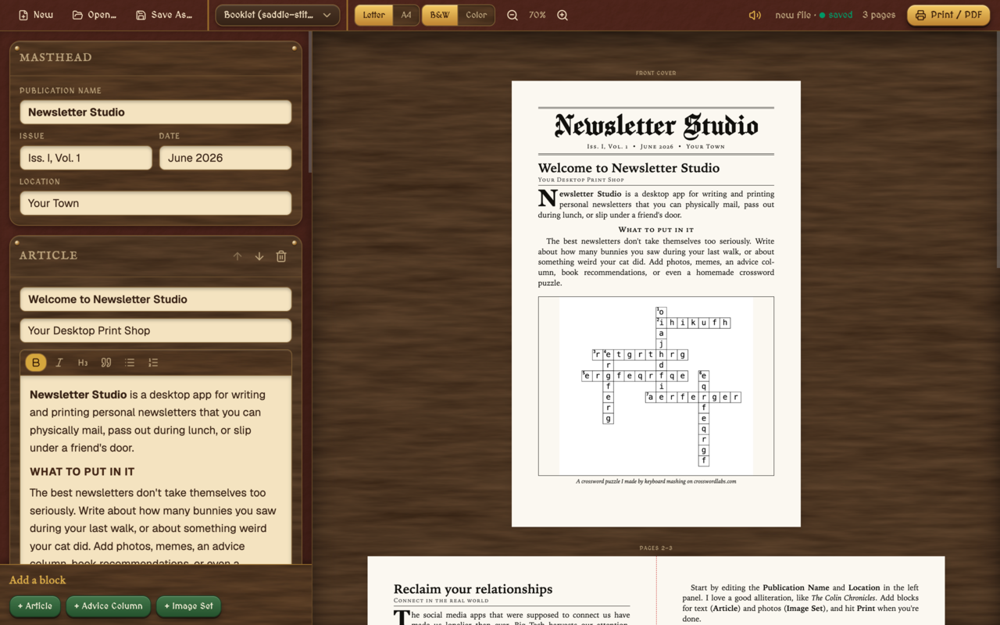

<h1 align="center">Newsletter Studio</h1>

<p align="center">Write and print a vintage-newspaper-style newsletter.</p>

<div align="center">
  <a href="https://github.com/c-o-l-i-n/newsletter-studio/actions/workflows/deploy.yml">
    
  </a>
  <a href="https://newsletterstudio.colinaw.com">
    
  </a>
  <a href="LICENSE">
    
  </a>
</div>

<br />
<br />

<p align="center">
  <a href="https://newsletterstudio.colinaw.com">
    
  </a>
</p>

## About

Newsletter Studio is a whimsical, offline-first PWA for authoring and printing a personal, vintage-newspaper-style newsletter. The app applies an opinionated, "print-ready" style and layout so you can just focus on writing.

### Privacy

There are no ads, trackers, or paywalls. There are no accounts, no servers, and no internet connection required (if you install the PWA). Projects files save to your computer, just like any other file.

### Technology Stack

[](https://www.typescriptlang.org/)
[](https://reactjs.org/)
[](https://vite.dev/)
[](https://tailwindcss.com/)
[](https://workers.cloudflare.com/)

### Code Quality

This was my first time vibe-coding an entire app without caring about code quality. The project is almost certainly well within "slop" territory.

## Getting Started

### Prerequisites

- [Git](https://git-scm.com/)
- [Bun](https://bun.sh/)

### Install

```sh
git clone https://github.com/c-o-l-i-n/newsletter-studio.git
cd newsletter-studio
bun install
```

### Run

```sh
bun run dev
```

## Author

<a href="https://github.com/c-o-l-i-n">
  
</a>

**Colin A. Williams**

Website: [colinaw.com](https://colinaw.com)
<br>
Github: [@c-o-l-i-n](https://github.com/c-o-l-i-n)

## License

Copyright © 2026 [Colin A. Williams](https://github.com/c-o-l-i-n).<br /> This project is [MIT](LICENSE) licensed.
